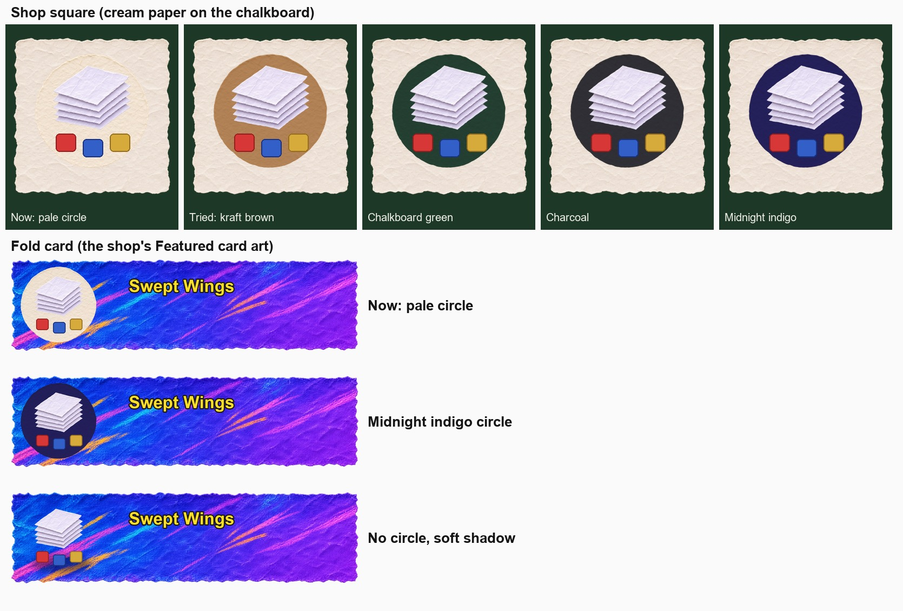
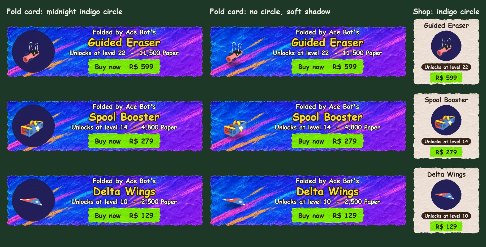
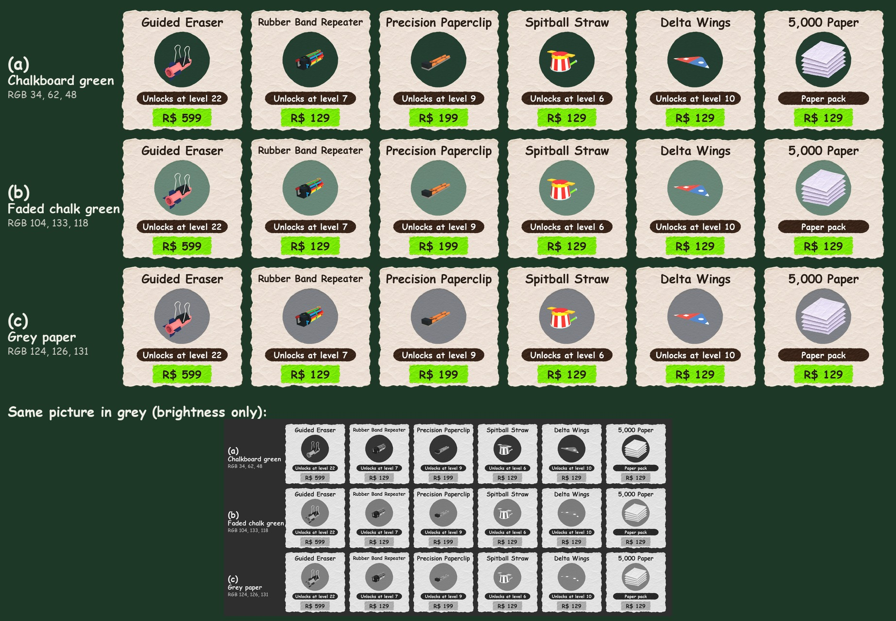
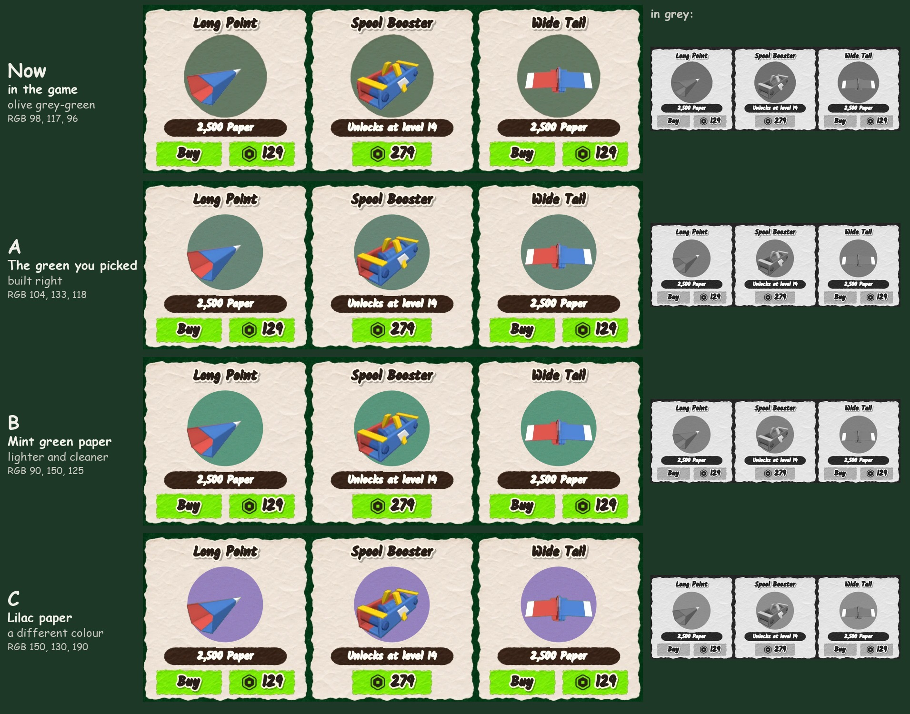
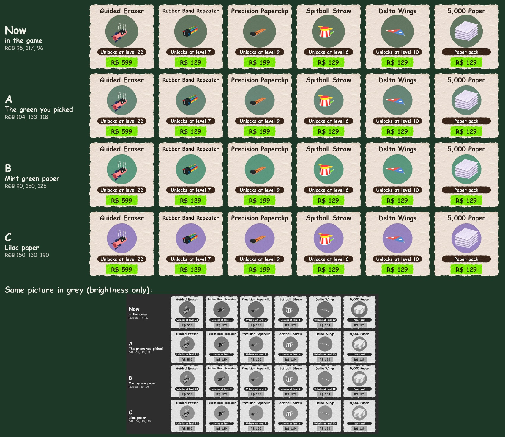

# Design examples

The design and colour rules live in the project skill `.claude/skills/design-theory/SKILL.md` (Claude loads it before
any screen, menu, card or picture work; its helper `.claude/skills/design-theory/contrast.py` measures contrast and
makes greyscale and "squint" copies of a screenshot). This page applies them to real problems. Recommendations here
are **not built**: Alan picks, then the change is made and checked in Play.

Contrast numbers are WCAG ratios (1:1 = same brightness, 21:1 = black on white). Items need about 3:1 against their
backing; body words 4.5:1.

**Where it stands (2026-11-12):** fold card: Alan chose **no circle, soft shadow** (being built). Shop: Alan turned
down midnight indigo (too dark: black and dark purple pieces blend in); the third study below compares mid-brightness
backings; Alan picked **faded chalk green** ([decision](../decisions/2026-11-12-fold-card-and-shop-mats.md)), then
saw it in Play and said it "just doesn't look right": the fourth study says why and gives three fixes for him to pick.

## The colour study (2026-11-12)

A mock-up from the real shop art (`item-square`, `circle-pale`, `card-featured`, `icon-stack`); the red, blue and
yellow squares stand in for part colours. Not a Play screenshot: check the picked one in Play before calling it done.

| Backing | White paper | Paper icon | Red part | Blue part | Yellow part |
|---|---|---|---|---|---|
| Cream / pale circle (now) 240,225,208 | 1.1 | 1.1 | 3.6 | 4.5 | 1.7 |
| Kraft brown (tried) 176,128,84 | 2.9 | 2.4 | 1.3 | 1.7 | 1.6 |
| Chalkboard green 34,62,48 | 9.8 | 8.0 | 2.5 | 2.0 | 5.4 |
| Charcoal 46,46,52 | 11.3 | 9.2 | 2.9 | 2.3 | 6.2 |
| **Midnight indigo 34,30,88** | **12.6** | **10.3** | **3.2** | **2.6** | **7.0** |

## With real parts (second study, 2026-11-12)
Alan on the first study: if there's a circle, midnight indigo works best, but the soft shadow can't be judged with a
paper stack. So the three options again with real part models:

How it was made: each part built by `Aircraft.build` and trimmed to its own pieces as `UnlockMoment.view` does, drawn
in Studio's Edit world high above the map with the picture's own camera angle and framing (40 degree view, turned
so the sun lights it from the same side as the picture light), Studio's post effects off, shot on black and on white
and cut out from the pair, then put on the real card art at the game's sizes. Close to the game, not a Play
screenshot: the lighting is the sun's, and the words are Comic Sans standing in for Kalam. The parts fill about half
their circle because that is how the game frames them (the fold card turns them slowly).

The parts' main colours, measured from the renders, against each backing:

| Part colour | On indigo 34,30,88 | On bare card blue 36,79,230 |
|---|---|---|
| Delta Wings blue 86,138,208 (44%) | 4.3 | 1.8 |
| Delta Wings red 241,90,79 (36%) | 4.5 | 1.9 |
| Wing and tape white 249,249,246 | 14.3 | 6.0 |
| Spool Booster blue 93,141,198 / 64,103,162 | 4.4 / 2.6 | 1.8 / 1.1 |
| Spool Booster yellow 234,197,48 | 9.0 | 3.8 |
| Guided Eraser pink 254,143,141 | 6.8 | 2.9 (1.7 on a magenta streak) |
| Guided Eraser black clip and navy fins 30,37,47 | 1.0 | 2.5 |

What it shows: **the indigo circle wins.** Without it, the blue parts sit on the card's own blue (about 1.1 to 1.8)
and the crayon streaks run straight through the parts (the pink Eraser on a magenta streak); the soft shadow helps a
little but the part still floats on a busy picture. With the circle every main colour stands out and the part has a
calm place to sit. Its one weak spot: very dark pieces (the Eraser's black clip and navy fins) are about as dark as
indigo; the silver clip handles and the pink body still carry the shape. If a dark piece gets lost in Play, light the
part a little brighter in its picture rather than lightening the circle (a lighter circle loses the whites).

## Shop backings at middle brightness (third study, 2026-11-12)
Alan on indigo for the shop: "when it's too dark... it makes the dark colors on the models blend in... it needs to be
a color behind it that doesn't take your eyes away from the model, but also contrasts with the white. Maybe in the
shop we go with the chalkboard green." Same method as the second study, with parts that have black, dark purple and
navy pieces (Guided Eraser, Rubber Band Repeater, Precision Paperclip) and white-heavy ones (Spitball Straw, Delta
Wings, the white Paper stack):

**Why middle brightness:** a backing can't be far from white and far from black at once. The brightness that is
equally far from both (relative luminance about 0.21, a middle grey) gives each 3.8:1, enough to stand out. Darker
helps white and hides black; lighter does the opposite. So (b) and (c) were solved to exactly that brightness.

| Part colour | (a) Chalkboard 34,62,48 | (b) Faded chalk green 104,133,118 | (c) Grey paper 124,126,131 |
|---|---|---|---|
| White paper and tape 249,249,246 | 11.1 | 3.8 | 3.9 |
| White Paper icon 219,210,231 | 8.0 | 2.8 | 2.8 |
| Black frame (Rubber Band, Paperclip) about 25,25,30 | 1.5 | 4.3 | 4.3 |
| Eraser navy fins 30,37,47 | 1.3 | 3.8 | 3.8 |
| Eraser dark purple 81,54,84 | 1.1 | 2.6 | 2.6 |
| Team red paper 241,90,79 | 3.5 | 1.2 | 1.2 |
| Team blue paper 86,138,208 | 3.3 | 1.1 | 1.1 |
| Yellow 234,197,48 | 7.0 | 2.4 | 2.4 |

- **Recommended: (b) faded chalk green, RGB 104,133,118** (`ImageColor3 = 111,151,145` on the same pale circle). Its
  brightness keeps both the white and the black pieces visible (the greyscale copy shows it best: on chalkboard the
  black frames disappear, on faded chalk green both ends show). It is the chalkboard's own green with chalk dust in
  it, so it belongs to the shop, and it is muted, so it doesn't pull the eye off the part. Red parts sit on their
  opposite colour, so they jump out.
- **Alternative: (c) grey paper, RGB 124,126,131** (`ImageColor3 = 132,143,161`). Same brightness, so the same
  contrast; no colour of its own, so no part colour ever blends with it. Flatter next to the crayon colours and not
  tied to anything else in the shop.
- (a) chalkboard green works for white and the team colours but hides black and dark purple pieces (1.1 to 1.5), the
  thing Alan wanted fixed. Also the circle matches the board around the square, so it can read as a hole.
- **The price of middle brightness:** the red and blue team paper is itself middle brightness (1.1 to 1.2), so on (b)
  or (c) it stands out by colour, not by light and dark (strong saturated red and blue on a soft dull green: clear in
  colour, it fades only in the greyscale copy). Most shop parts are team paper (bodies, noses, wings, tails), so check
  a few in Play before committing to it.

## Why the green looks wrong in Play (fourth study, 2026-11-12)
Alan, after seeing faded chalk green in the shop in Play: "It just doesn't look right." Checked on his screenshot
(`.planning/shop-green-alan-2026-11-12.webp`) with the `design-theory` skill:

1. **It isn't the colour he picked.** The game tints the cream circle picture (`ImageColor3` multiplies), and the code
   sets the target colour itself (104,133,118) as the tint, so cream times green came out **98,117,96** on screen:
   darker, greyer and turned toward yellow-green (hue 141 instead of 161 on the CIELAB colour wheel). The right tint
   for 104,133,118 is 111,151,145.
2. **That olive grey-green is the least-liked kind of colour.** In the main colour study the dip in liking sits at
   yellow-green, the lowest point is olive, and saturated colours beat muted ones (C1). People link it with mould and
   mud; a dull, dirty-looking disc sits under a bright toy.
3. **It's the only dull colour on a bright screen.** Everything around it is clean: cream paper, lime buttons, the
   yellow banner, crayon-bright cards. One greyed-down colour among them reads as dirt or a shadow, not paper (C1;
   older kids like softer colours, but attention fell when colours went washed-out, C5).
4. **It reads as a hole, and it touches the price label.** A darker disc in the board's own colour family, with no
   edge, looks like a hole through the paper (L1: same colour = same thing). Its bottom is 3 concept pixels from the
   dark price label, so the two dark shapes merge into one blob (L1: nearness groups).
5. **The parts look flat on it.** The red and blue paper are the same brightness as the circle (1.0 to 1.4), so they
   stand out by colour only (C7: same brightness looks flat). That was the known price of middle brightness.

Made by repainting the circles on Alan's own screenshot (the parts are untouched), and on the third study's real-part
squares. The options use a circle 186 across instead of 205, centred where it was, which leaves 13 concept pixels of
cream above the price label.

| Option | On screen | `ImageColor3` on the pale circle | White | Black frame | Navy | Dark purple | Red / blue paper |
|---|---|---|---|---|---|---|---|
| Now (in the game) | 98,117,96 | 104,133,118 | 4.5 | 3.7 | 3.2 | 2.2 | 1.0 to 1.4 |
| **A** the green he picked, built right | 104,133,118 | 111,151,145 | 3.8 | 4.3 | 3.8 | 2.6 | 1.1 to 1.2 |
| **B** mint green paper | 90,150,125 | 96,170,153 | 3.3 | 5.1 | 4.5 | 3.0 | 1.0 to 1.4 |
| **C** lilac paper | 150,130,190 | 159,147,233 | 3.2 | 5.2 | 4.6 | 3.1 | 1.0 to 1.4 |

- **Recommended: B, mint green paper.** It keeps green, the one colour family far from both the red and the blue
  parts, but moves it away from yellow-green toward the sea-glass side that people like (C1: liking peaks at blue and
  cyan), lighter (C3: brightness drives pleasure) and almost twice as colourful, while staying well below the lime
  buttons, so it doesn't pull the eye off the part (C3, L11). It clears 3:1 for white and for every dark piece,
  including the Eraser's dark purple, which A doesn't. Cleaner and lighter, with the gap, it reads less like a hole
  (judge that on the picture: it's an eye call, not a measurement).
- **A** is the cheapest fix (the right tint and the gap), and it is the colour Alan saw in the mock-ups, but still
  muted and grey.
- **C** is a different colour family: nothing like the board, so no hole, and it goes with the purple 2x XP card.
  Blue parts sit next to its hue, so they stand out least of the three.
- **For all three:** shrink the circle so it doesn't touch the price label. In `ShopScreen.luau`'s Today's parts,
  `backing(card, 109, 73, 295, 259)` instead of `backing(card, 100, 64, 305, 269)`; check the starter pack and week
  squares the same way on a screenshot.

## Fold card: the pale circle
`src/client/FoldOffer.luau` puts the part on `Art.circlePale` on the Featured card's blue-violet crayon. Alan: the
white circle "just doesn't look good".

Why it fails: it is the lightest, largest, flattest shape on a dark, busy, cool card, so it wins figure-ground and
reads as a hole or a sticker; it is warm cream on a cool card, so it jumps forward; it takes the "one loud thing" from
the part and the buy button; and white parts on it vanish (1.1:1).

- **Recommended: a midnight indigo circle, RGB 34,30,88.** Same circle picture, tinted: `ImageColor3 = 36,34,108`
  (the pale paper times that tint gives about 34,30,88, keeping its torn edge and texture). Analogous to the card's
  blue and violet, so it belongs to the card instead of sitting on it; dark and cool, so it sits back; the part is
  now the brightest thing on the left, so it becomes the figure (white paper 12.6:1).
- **Alternative: no circle, a soft shadow.** Drop the circle and put a blurred dark oval under the part (RGB 10,10,40,
  about half see-through) so it sits on the card. The card itself is dark enough for white paper (5.8:1) and the
  card art stays whole. Weaker: the magenta and orange streaks run behind the part, and blue parts sit on blue (1.2:1).

## Shop pictures: white things on cream
*First-study reasoning; Alan turned down indigo for the shop, see the third study above for the current pick.*

`src/client/ShopScreen.luau` shows parts (white paper bodies and wings, red, blue, yellow, grey pieces) and the white
Paper icons on cream paper (`Art.itemSquare`, `Art.circlePale`). Alan wants a backing that contrasts with white; the
brown kraft circles "looked very bad" and off-white is no good.

Why kraft failed: it is a middle value, so it contrasted with nothing (2.9 with white, 1.3 to 1.7 with the colours);
a warm, dull brown among saturated crayon papers looks muddy; and it is the cork board's colour family.

- **Recommended: the same midnight indigo circle, RGB 34,30,88 (`ImageColor3 = 36,34,108`), behind every picture
  that sits on paper:** Today's parts, the starter pack's items, the pass circles, Your next part and the fold card.
  Similarity: one backing for one job, and the fold card stays the shop's Featured card. Picture on indigo inside
  cream reads like a photo mounted on dark card in a paper frame. Layout: on a Today's parts square keep the circle
  about 180 across, centred on the part, with at least 15 of cream between it and the dark price label (proximity: two
  dark shapes touching merge into one).
- **Alternative: charcoal, "black construction paper", RGB 46,46,52 (`ImageColor3 = 49,52,64`).** How teachers mount
  kids' drawings; neutral, so it suits every card colour. Heavier and gloomier than indigo, and on the chalkboard it
  starts to look like a hole.
- Not recommended: chalkboard green (34,62,48). The squares sit on the chalkboard, so a green circle reads as a hole
  through the paper to the board.
- Weak spot for both: mid-blue parts (2.6:1, and the same hue family on indigo). If a blue part gets lost, light the
  part brighter in its picture rather than changing the mat.

## Related
- [Fold card and shop picture decision](../decisions/2026-11-12-fold-card-and-shop-mats.md) (open until Alan picks)
- [Menus and HUD](../systems/menus-and-hud.md) · [Lessons learned](lessons.md) · [Testing](testing.md)

Back to [HOME](../HOME.md)
